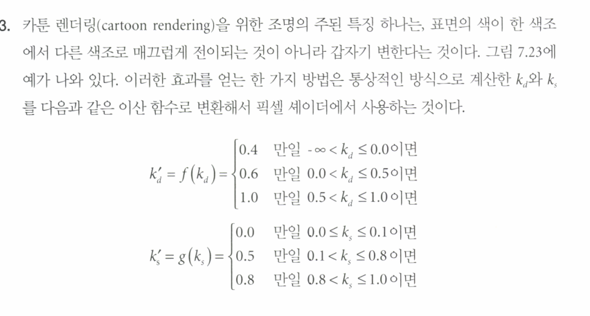
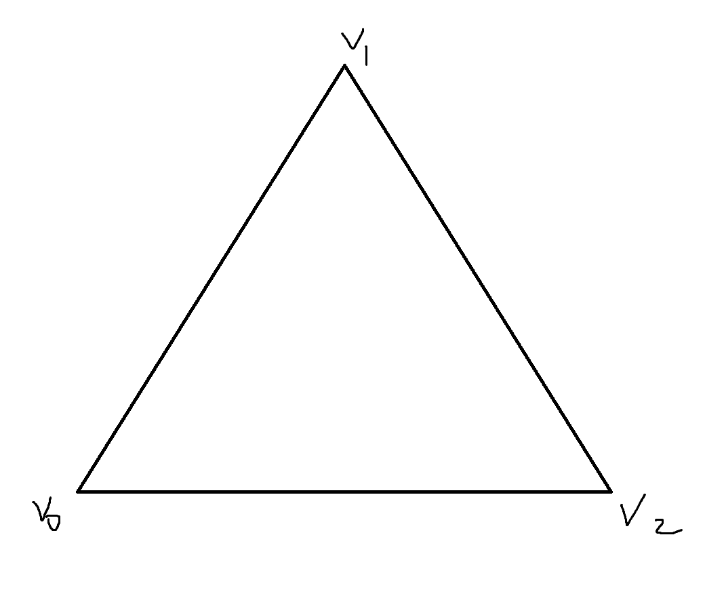
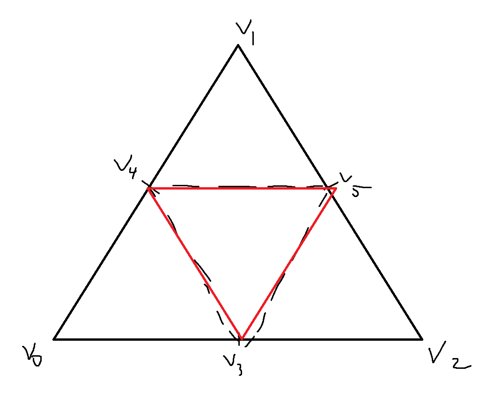
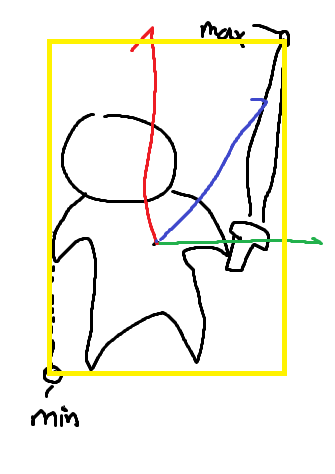
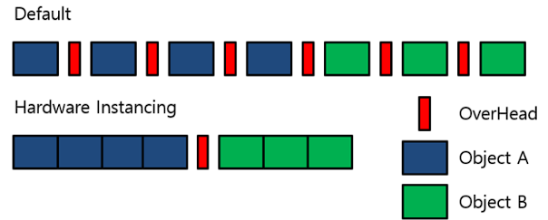
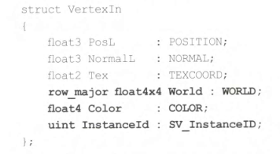
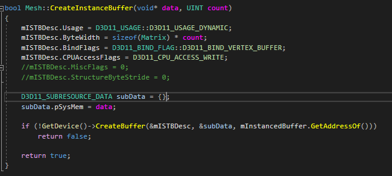
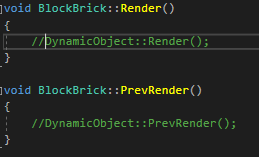
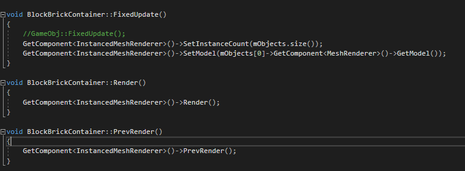

---

<b>카툰렌더링</b>

첨부된 사진과 같이 렌더링되는 색의 범위를 일정 범위로 clamp 해버리면 된다.

<a href="https://agh2o.tistory.com/21">agh2o.tistory.com</a>

<b>SubDivision</b>

간단한 모델을 상세한 모델로 만드는 기법

<b>테셀레이션단계</b>에서 사용되는 기법이다. (cpu에서 사용하기에는 비용이 높다)

SubDivision에는 여러가지 방법이 있다 여기선 한가지 방법을 소개한다.

상세한 모델로 만드려면 당연히 삼각형의 수를 늘려야한다.

모델을 해치지 않는 선에서 늘리려면 기존 삼각형에서 늘려야한다.

여기서는 삼각형을 4개로 나누겠다.

이럼 끝이다. 

기존 인덱스 데이터가 012였다면 여기선

043 415 345 352가 들어가면 되겠다.

<b>Clipping vs Culling</b>

View frustum에 들어가지 않는 물체를 미리 걸러내서 아예 그리지 않는 것을 culling이라고 하고 Draw() 호출로 그리라고 명령 들어온 삼각형들 중에서 view frustum가장자리에 걸려있는 것들을 잘게 잘라서 그리는 것을 clipping이라고 합니다.

물체 단위의 culling은 보통 우리가 구현합니다. backface culling 정도는 DirectX가 해결해줍니다. Clipping은 보통 GPU에게 맡기며 알고리즘이 그래픽 카드 드라이버에 내장되어 있을 것으로 생각됩니다.

아직까지는 culling은 CPU에서 구현해서 아예 Draw() 호출 전에 빼버리는 것이 대세인 것으로 알고 있는데, 요즘은 culling도 우리가 쉐이더를 만들어서 GPU에서 구현하기도 합니다. 결국은 CPU culling 구현이 편한 부분은 CPU에서 하고 GPU가 더 편하거나 효율적인 부분은 GPU에서 구현할 것으로 예상합니다.

---

<b>Frustum culling</b>

말 그대로 카메라의 frustum에 들어오지 않은 오브젝트를

렌더링 파이프라인 위에 올리지 않는 최적화 기법이다.

그럼 메쉬가 절두체의 밖인지 안인지는 어떻게 판단해요?

- 메쉬크기만한 Box를 만들어 그 Box가 Frustum 밖에 있으면 밖에있다고 처리하면 된다.
  

  이런 느낌이다. (노란 Box를 Bounding Box 라고 한다)

  모든 모델을 이런 Box로 감싸면

  Box의 모든 면은 World 기저에 평행하는 모양이 될 것이다.

  따라서 우리는 AABB 충돌 판정으로 박스와 절두체의 충돌을 판단할 수 있다.

  Oriented Bounding box로도 가능하다.

  axis alligned bounding box보다는 정교할 것이라고 생각된다..

  directX에서는 \<DirectXCollision.h> 에 Bounding Box나

  Frustum같은 구조체 멤버들이 구현되어있어서 걱정하지 않아도 된다.

  Bounding Box는 위의 그림처럼 메쉬의 모든 정점을 순회하면서 최대 최소값을 찾아 만들고

  Frustum은 Projection 행렬로부터 구해진다.

  해당 메쉬의 Bounding Box와 카메라의 Frustum이 Intersect중일때만

  Bindbuffer 및 렌더링 해준다.

  프러스텀 컬링 On

  <video controls preload="metadata" src="../media/e3e82a468bfc3cbdc431.mp4"></video> <a href="../media/e3e82a468bfc3cbdc431.mp4">2023-10-23_16-29-49.mkv</a>

  Off ( 항상 47로 나온다)

  <video controls preload="metadata" src="../media/6906d78e643368afc7df.mp4"></video> <a href="../media/6906d78e643368afc7df.mp4">2023-10-23_16-31-09.mkv</a>

<b>인스턴싱</b>

같은 물체를 여러번 그릴 때 매번 vertex, index data를 파이프라인에 넘겨주는 것은 낭비이고

실제로 오버헤드로 가 많이 발생해서 렌더링 과정이 느려지게 된다.

같은 메시를 100개 그린다고 하면 메시의 vertex, index정보를 하나만 저장해 두고

필요에 따라 world matrix와 material들만 다르게 두면

DP Call이 줄어들 것이다.

말만 들었을때에는 각 메시의 정보를 저장하는 메모리만 절감될 것 같지만

DP Call 자체를 줄일 수 있는 메커니즘을 DX에서 제공한다.

이를 하드웨어 인스턴싱이라고 부른다.

---

인스턴싱을 사용하지 않으면 물체를 오브젝트를 조금만 많이 렌더링해도 속도가 느려진다

<b>BrickBlock 300개 렌더링</b>

<b>25fps</b>

<video controls preload="metadata" src="../media/d799a19d7468cd916293.mp4"></video> <a href="../media/d799a19d7468cd916293.mp4">2023-10-18_17-05-36.mkv</a>

하드웨어 인스턴싱에서는 Input Layout에 인스턴스별 자료도 전달한다.

(나는 Material을 사용중이기 때문에 Color는 필요가 없다)

CPU에서도 Input Element Desc에 위에서 추가한 항목들을 추가해준다.

D3D11\_INPUT\_ELEMENT\_DESC 내에는 Instance를 사용하기  위한 두 개의 멤버가 있다.

<b>InputSlotClass</b>

입력  원소를 vertex자료로 넘길지 인스턴스별자료로 넘길지 결정  <b>InstanceDataStepRate</b>

인스턴스별 자료 원소당 그릴 인스턴스 개수 (1:n 매칭이면 n vertex면 0)

그릴때 DrawIndexed를 여러번 호출하는게 아니라 DrawInstanced를 한번만 사용한다.

GPU에게 계속 갱신되는 World 정보를 넘겨줘야 하기 때문에

cpu access flag를 cpu write로 설정하고

buffer를 적당한 크기로 만들어 놓는다.

이 버퍼는 오브젝트들의 위치좌표를 업데이트 해야하기 때문에

매 프레임 업데이트를 해주어야 한다. (Mapping을 사용한다)

나는 인스턴싱 할 객체들의 렌더링을 막아두고 상위 객체인 container를 만들어서

그곳에서 하나의 객체만 render을 호출하도록 했다.

<b>60fps 정상</b>

<video controls preload="metadata" src="../media/53771ecbe7a7dd53b00c.mp4"></video> <a href="../media/53771ecbe7a7dd53b00c.mp4">2023-10-19_14-59-26.mkv</a>

블록 1000개도 50프레임 정도를 뽑아냈다.

---

---

DrawIndexedInstanced함수를 사용하면 정점 데이터를 교환하지 않고 재사용한다.
