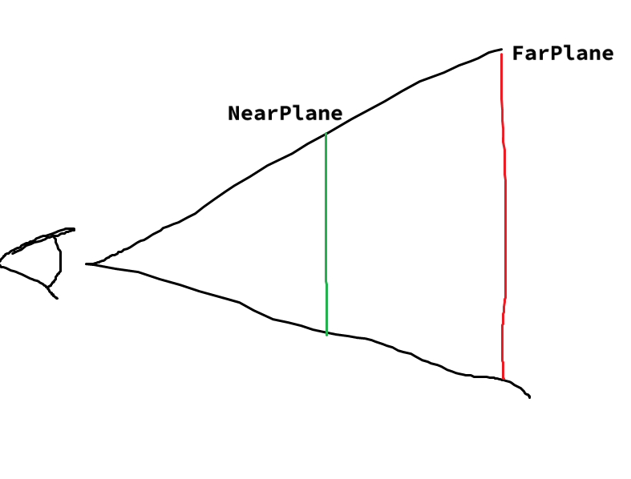

---

큐브맵의 worldPos는 항상 0,0,0이다.

이를 유지하기 위해 큐브맵은 방향을 가지고 있으면 안되고 w를 0으로두어 point로 처리한다.

하지만 큐브맵은 항상 제일 멀리 렌더링 되어야 한다.

즉 NDC의 FarPlane에 렌더링 되어야 한다는 것이다.

따라서 view 공간에서의 큐브맵의 w값은 vector로 처리한다.

hlsl 기준으로 TextureCube에 dds(큐브맵 텍스처 파일)파일을 리소스로 전해준 후

큐브 매쉬pixel 방향으로 샘플링 해주면 된다.
