---

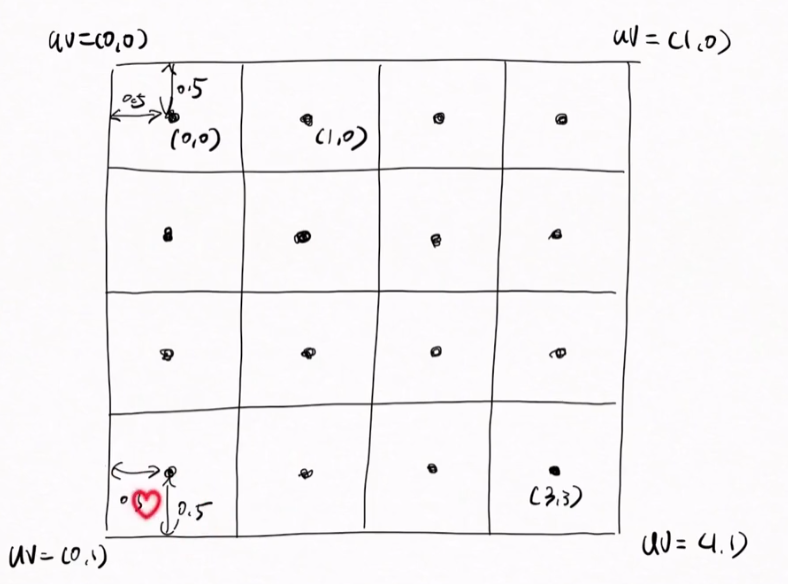

- 우리가 생각하는 텍스처 좌표는 0,0 \~ 3,3 이지만
  텍스처 좌표가 그 텍스처의 중심(0.5, 0.5)이라고 가정했을때

  해당 픽셀의 좌표는 그림과 같이 확장된다.

  즉 -0.5 \~ w + 0.5,  -0.5 \~ h + 0.5가 된다.

<b>Point Sampling</b>

- 픽셀을 그대로 렌더링해준다.

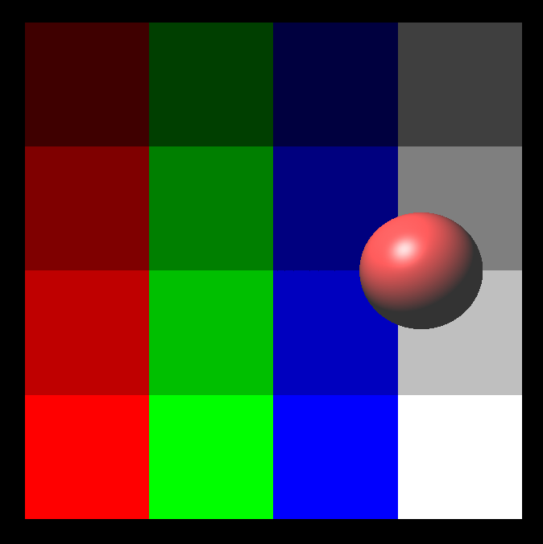

<b>Linear Sampling</b>

- Linear interporation 을 사용해서 linear sampling 이다.
- 텍스처의 색상값을 보간하기 때문에 point보다 부드럽게 표현된다.

<b>Clamp/Wrap 차이</b>

- sampling 중 <b>clamp</b>를 사용하면 uv 인덱스를 절때 0 \~ 1사이에 가둬서 텍스처가 원래 형태로 샘플링된다.
  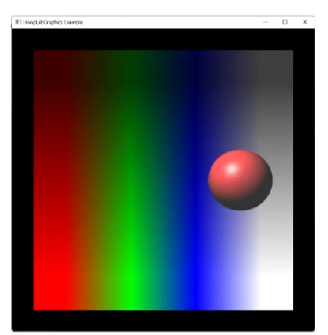
- <b>Wrap</b>는 uv가 0밑으로 떨어지면 반대편인 uv1에서 색상값을 가져오고 반대로 1이 넘어가면 uv 0 에서 색상값을 가져온다.
  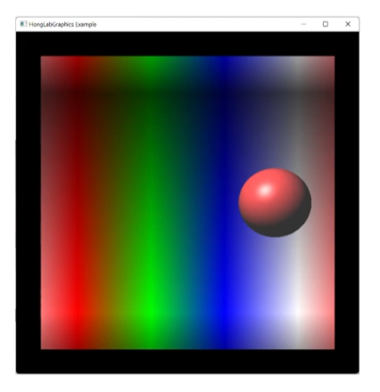

<b>BiLinearSampling</b>

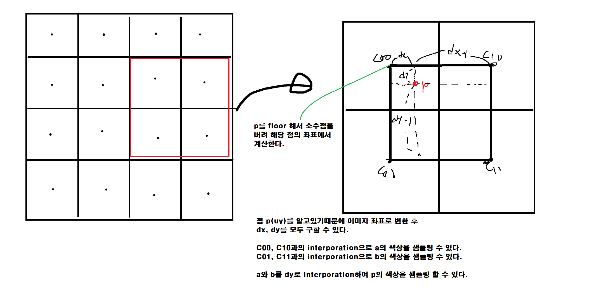

이렇게 보간을 2번하여 그 정보로 2차원 보간을 해내는 것을 BilinearSampling이라고 부른다.

wrapped를 사용해서 이런짓도 가능하다

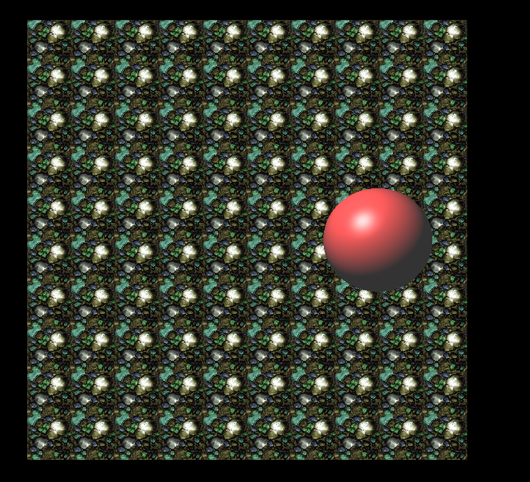

SuperSampling

한 모니터 픽셀에서 1개가 아니라 다수의 Ray를 쏜 후 평균을 낸다.

따라서 ray를 4개를 쏘면 해상도가 4배 증가한 것 과 같은 효과를 낸다고 볼 수 있다.

(1 픽셀당 4개의 픽셀이 추가로 있다고 가정하기 때문)

그 후 4배 증가한 해상도를 다시 기존의 픽셀에 적용하는 느낌

여러가지 방법이 있지만

홍박사님 강의에서는 

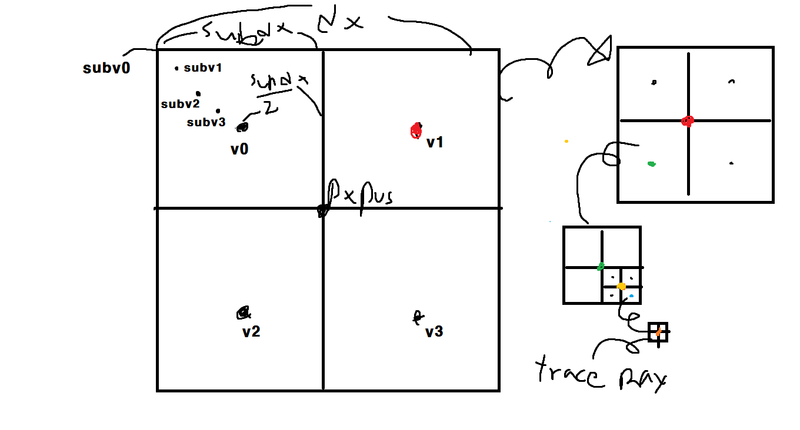

<b>일반샘플링</b>

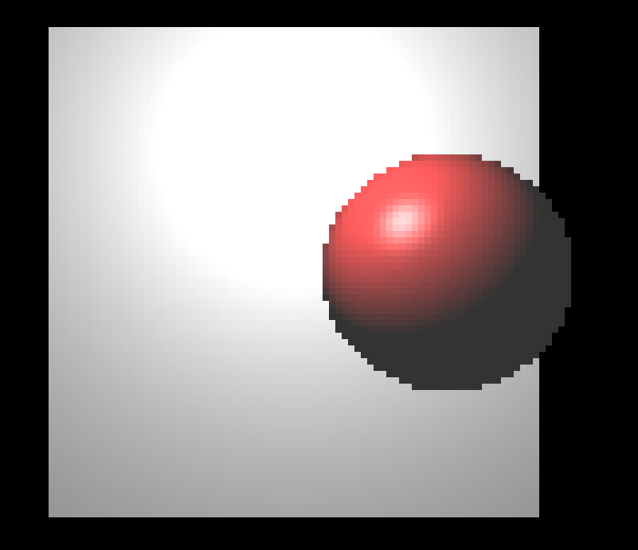

<b>수퍼샘플링</b>

계단현상을 줄이고 있다.

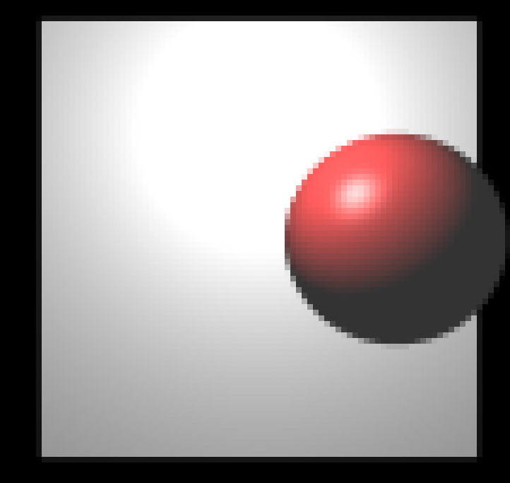

Super Sampling은 Anti Aliasing의 한 종류이다.

Anti Aliasing은 모니터에 Display되는 Object Edge를 부드럽게 만들기 위한 방법이다.

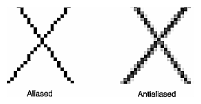

<b>SSAA(super sampling anti aliasing) vs MSAA(multi sampling \~\~)</b>

- SSAA 해상도 자체를 높이는 방식이라 연산량이 엄청나다.
- MSAA는 SSAA의 연산량 문제를 해결하기 위한 방법이다.
  - SSAA보다 pixel shader의 연산이 적다.

아래는 이해를 돕기위한 이미지들이다.

<b>원본</b>

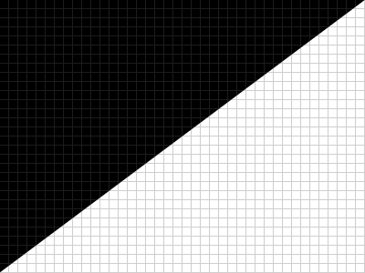

noAA

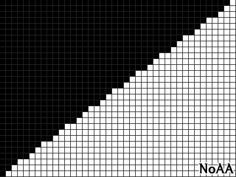

SSAA

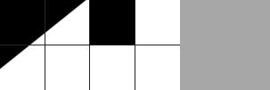

1. 현재 이미지를 더 큰 해상도의 이미지로 불러 온다
2. 비트맵 화 한다. ( 검은색이 절반 이상 포함되어있음 검정색 아닌건 흰색)
3. 원래 해상도로 내리면서 평균치를 낸다.

MSAA

한 픽셀 위의 n개의 샘플을 구해서 평균을 구한다.

---

---

간단하다 메시에 텍스처를 입히는 것을 말한다.

텍스처를 처리할 때 이미지를 샘플링 하는 방식에 따라 다양한 결과가 나타난다.

- [Spherical Harmonics](%EA%B5%AC%EB%A9%B4-%EC%A1%B0%ED%99%94-%ED%95%A8%EC%88%98-0b61f923.md)

- [Importance Sampling](%EC%9E%84%ED%8F%AC%ED%84%B4%EC%8A%A4-%EC%83%98%ED%94%8C%EB%A7%81-ba646584.md)
