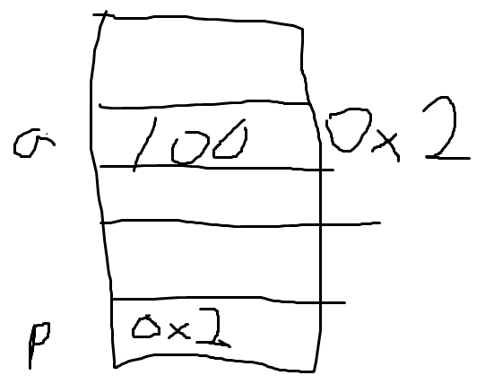
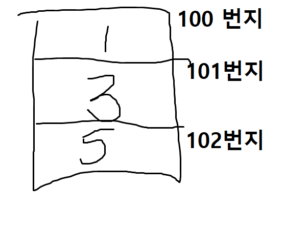

### <b>포인터</b>

메모리는 데이터가 저장되는 <b><span>부분의 위치(주소)</span></b>를 가지고있음

포인터 변수는 그 주소를 받아주는 변수

포인터변수(주소)는 <span>32bit </span>기준 <b><span>4바이트 정수</span></b>가 <b><span>16진수</span></b>로 표현된다.

                           <span>64bit </span>기준 <b><span>8바이트 정수가 16진수</span></b>로 표현된다

<ul>
<li>
선언법 

```c++
void* p = &a // 변수 a의 주소를 p에다가 주겠다.  
```
</li>
<li>
메모리에 할당되는 방식
</li>
</ul>



<b>배열의 포인터</b>

배열을 선언하면 메모리에 연속된 주소로 만들어짐

int arr\[3\] =\{1,3,5\};를 하면 메모리에는



요렇게 들어감

ex) print(arr);  arr\[0\]번의 주소를 넘겨준것 (배열의 이름은 배열의 주소)

```c++
 arr[i] == arr + i
```

                    (arr + 1을 하면 arr\[1\]을한것 (+1을 하면 그 자료형의 크기만큼 이동))

내가 arr의 모든 값을 바꾸고싶으면 arr의 모든값(12바이트)을 넘겨주는게 아니라<br /><b>시작 주소(4바이트)</b>만 넘겨줘서 함수에서 그 주소로 접근해 <b>적은 비용</b>으로 사용 가능

포인터주소가 가리키는 값을 받고싶으면 포인터변수 p앞에 \*을붙여서

\*p 이렇게 접근

<b>포인터변수가 가리키는 주소의 Data를 변경하면 원본 데이터가 변경된다.</b>

(당연함 → 원본의 주소를 가지고 있으니까)

<b>32bit / 64bit - 운영체제에서 한번에 처리할 수 있는 비트수</b>

32bit 운영체제에서는 8gb 메모리를 꽂아도

32bit으로 나타낼수 최대값이 2\^32(42억)임 그래서 42억(4gb)이 넘어가는 주소는 얘가 뭐 

알수가 없음

### 포인터 변수의 <b><span>NULL</span></b>은 <b><span>nullptr</span></b>로 사용한다.

<b>2중포인터</b>

<b>2중포인터</b>는 <b>포인터를 값</b>으로 가지고 있는  포인터

2중포인터 변수 ppNum의 내부 값 접근법 

→ \*(\*(ppNum))

int(\*parr2D)\[4\] = arr2D; → 4칸짜리 포인터배열

<b>배열 포인터</b> -> 배열의 시작점을 가지고 있는 포인터

<b>포인터 배열</b> -> 포인터를 가지고 있는 배열

<b>포인터변수와 const 포인터</b>

<b><span>const 자료형\* p = &a; ⇒ </span></b><b>값을 변경하지 못하는 포인터변수</b>

<b><span>자료형\* const constp = &a; ⇒ </span></b><b>주소를 변경하지 못하는 포인터변수</b>

<b>함수포인터 변수</b>

포인터에는 변수의 주소뿐만 아니라 함수의 주소도 담을 수 있다.

```c++
자료형 (*변수명) (매개인자);
int (*minus) (int, int); // 반환값이 int 매개인자가 int, int인 함수를 받을 수 있는 pointer임
```

event 방식 호출에 사용

유동적? 으로 사용할때?

ex) ui틀에다가 항목들 교체하기


---

아 그래서 왜쓰는데?\~\~?

---

## 포인터

- 자료가 저장되는 기억장치의 주소이자
  다른 기억장소의 자료를 참조하는데 사용되는 데이터

  ⇒ <b>변수의 주소를 저장하거나 사용하기 위해 사용한다.</b>

컴포는 변수를 참조할 때 변수가 저장된 주소를 먼저 찾아내고 주소가 가리키는 데이터를 참조한다.

<b>장점</b>

- 메모리에 직접 접근이 가능
- 구조화된 자료를 만들어 효율적인 운영 가능
- Call by Reference 방식 사용 가능
- 복잡한 자료구조와 함수에 쉽게 접근 가능
- 동적할당 가능

굳이 단점을 뽑다면 메모리에 직접 접근이 가능하기에 사용에 유의해야하고

메모리누수, 댕글링포인터, 와일드포인터(초기화가 안되서 엉뚱한 곳 가리키는 포인터) 현상을 주의해야한다.

<b>특히 포인터 오류는 프로세스를 종료시킨다.</b>
