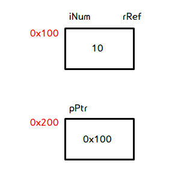

비슷한듯 다른 포인터와 레퍼런스의 차이에 대해 알아보자\~

---

### <b>포인터</b>

- 메모리 주소를 가지고 있는 변수
- 주소값을 통한 메모리 접근을 한다 (간접참조)

### <b>레퍼런스(참조자)</b>

- 자신이 참조하는 변수를 대신할 수 있는 또 하나의 이름
  즉 변수에 별칭을 하나 붙여주는것이다.

- Null 초기화가 불가능하다
  (선언과 동시에 가르킬 대상을 정해야함)

- 초기화 이후 가르키는 대상을 변경이 불가능하다.

- 참조는 기존 객체에 대한 별칭이다. 참조를 구현하는 데 별도 저장 공간이 필요한지는 구현에 따라 달라질 수 있다.

이러한 특성때문에

Call by Pointer/Reference의 차이가 일어난다
