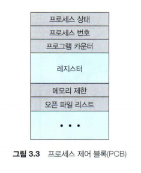
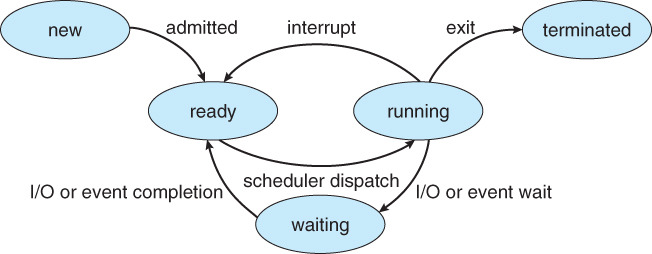
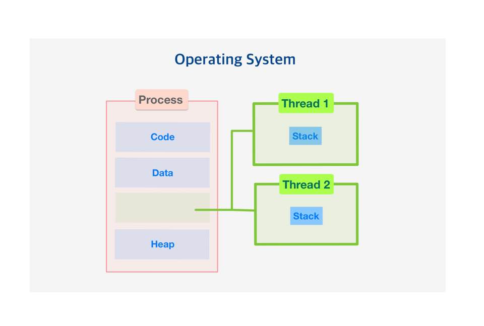

이 셋 차이를 알아보자\~

---

### Program

프로그램의 의미는 어떤 작업을 하기 위해 해야할 일들을 순서대로 나열한 것으로

쉽게말해 <b>컴퓨터에서 어떤 작업을 위해 실행할 수 있는 </b>

<b>'정적인(멈춰있는) 상태'의 파일</b>이라고 볼 수 있다.

<code>ex. Windows의 경우 exe파일</code>

컴퓨터에서의 '프로그램'은 사용자가 원하는 일을 처리할 수 있도록 프로그래밍 언어를 사용하여 올바른 수행절차를 표현해 놓은 명령어들의 집합이다. 그에 필요한 데이터를 묶어 놓은 파일로 보조 기억장치에 저장되어있다.

### Process

<b>프로그램이 실행되서 돌아가고 있는 상태, 컴퓨터에서 연속적으로 실행되고 있는 </b>

<b>'동적인 상태'의 컴퓨터 프로그램이다.</b>

ctrl+alt+delete의 작업관리창에 표시되어있는 것들이<b> 동적인 상태의 프로그램</b>

즉, 프로세스인 것이다.

<blockquote>

프로세스는 운영체제가 메모리 등의 필요한 자원을 할당해준 '실행중인 프로그램'이다.

<b>프로그램을 실행하면 운영체제로부터 실행에 필요한 자원을 할당받아 '프로세스'가 되는 것</b>이다.

</blockquote>

<b>프로세스가 할당받는 시스템 자원의 예</b>

- cpu시간
- 운영되기 위해 필요한 주소 공간
- Code, Data, Stack, Heap의 구조로 되어있는 독립된 메모리 영역

<b>프로세스의 특징</b>

<ul>
<li>
독립된 메모리 영역을 할당 받는다. (<b>Code, Data, Stack, Heap</b>)
</li>
<li>
각 프로세스는 <b>별도의 주소 공간에서 실행</b>되며, 서로 <b>독자적인 메모리 공간</b>을 갖기 때문에 

<b>서로 메모리 공간을 공유할 수 없다</b>. 즉, <b>다른 프로세스의 변수나 자료구조에 접근할 수 없다</b>.
</li>
<li>
다른 프로세스의 자원에 접근하려면 프로세스간의 통신(IPC)을 사용해야한다.
</li>
<li>
프로세스는 <b>최소 하나 이상의 스레드를 포함</b>한다.
</li>
</ul>

<b>프로세서의 프로세싱</b>

옛날엔 컴퓨터가 한번에 하나의 동작밖에 수행하지 못했다.

하지만 다중작업을 가능하게하는 멀티태스킹 기능이 나오면서 컴퓨터가 프로세스 여러개를 함께 돌리는 것이 가능해졌다.

✔️ <b>프로세서</b> :컴퓨터 내에서 프로그램을 수행하는 하드웨어 유닛이다. 이는 중앙 처리 장치(CPU)를 뜻하며 명령어를 해석하는 컴퓨터의 한 부분이다.

✔️ <b>멀티 프로세싱</b> : 여러 개의 프로세스를 사용하는 것

✔️ <b>멀티 태스킹</b> : 같은 시간에 여러 개의 프로그램을 띄우는 것

여러 프로세스들을 한꺼번에 돌리는 작업은 동시적, 병렬적, 또는 이 둘의 혼합으로 이뤄진다.

<b>프로세스의 동시성(Concurrency)</b>

프로세서는 원래 한번에 하나의 프로세스만 실행시킬 수 있다.

때문에 동시성은 프로세서 하나가 프로그램 1,2,3,4 여러 작업을 돌아가며 일부분씩 수행하는 방식이다.

이렇게 진행중인 작업을 바꾸는걸 <b>'Context Switching'</b>이라고 부르는데 이 과정이 매우 빠른 속도로 돌아가게 되면서 사람들에게는 이 프로세스들이 동시에 진행되는 것 처럼 보인다.

<b>프로세스의 병렬성(Parallelism)</b>

병렬성은 <b>프로세서 하나에 코어 여러개</b>가 달려서 <b>각각 동시에 작업</b>을 하는 방식이다.

듀얼코어, 쿼드코어, 옥타코어와 같은 명칭의 프로세서가 달린 컴퓨터에서 할 수 있는 방식이다.

코어를 여러개 달아 작업을 분담하게 만든것이다.

### PCB

프로세스는 운영체제에서 프로세스 제어 블록(Process control block)에 의해 표현된다.

PCB는 특정 프로세스와 연관된 여러 정보를 수록하며 그림 내에 있는 항목들을 포함한다.

- <b>프로세스 상태</b>

해당 다이어그램처럼 기록하고 있다.

- <b>프로그램 카운터</b>
  이 프로세스가 다음에 실행할 명령어의 주소를 가리킨다.

- <b>CPU레지스터들</b>
  누산기, 인덱스 레지스터, 스택 레지스터, 범용 레지스터들과 상태 코드 정보가 포함된다.

  프로그램 카운터와 상태 코드 정보는 프로세스가 다시 스케줄 될 때 올바르게 실행되도록

  인터럽트 발생시 저장되어야 한다.

- <b>CPU 스케줄링 정보</b>
  프로세스 우선순위, 스케줄 큐에 대한 포인터와 다른 스케출 매개변수를 포함한다.

---

여기까진 컴퓨터에서 여러 프로세스를 함께 돌릴 수 있게 된 것에 대한 설명이다.

브라우저 또한 하나의 프로그램이고 브라우저가 돌면서 하나의 프로세스가 진행되게 된다.

하지만 브라우저가 실행중일때도 게임을 다운받고 웹서핑을하거나 노래를 듣는 등,

<b>한 프로세스안에서도 여러가지의 작업들이 동시에 진행</b>되는 경우가 생긴다.

이런 여러가지 작업으로 생기는 이 갈래들을 <b>쓰레드(Thread)</b>라고 부른다.

### Thread

<b>스레드(thread)는 프로세스가 할당 받은 자원을 이용하는 실행 단위이자, 프로세스의 특정한 수행 경로이자 프로세스 내에서 실행되는 여러 흐름의 단위이다.</b>

스레드는 프로세스 내에서 <b>프로세스의 자원을 이용</b>해서 <b>실제로 작업을 수행하는 일꾼</b>이다.

스레드가 소속된 프로세스가 운영체제로부터 자원을 할당받으면 그 자원을 스레드가 사용한다.

프로세스는 최소 한 개 이상의 스레드를 가지며

기본적으로 가지는 스레드를 <b>메인 스레드(main thread)</b>라고 한다.

<b>스레드의 특징</b>

- 각 <b>스레드는 독자적인 스택(Stack) 메모리를 갖는다.</b>
- 스레드는 프로세스 내에서 각각 스택만 할당받고 <b>Code, Data, Heap 영역은 공유한다.</b>

- 스레드는 한 프로세스 내에서 동작되는 여러 실행의 흐름으로, 프로세스 내의 주소공간이나 자원들을 같은 프로세스 내의 스레드끼리 공유하며 실행된다.
- 각각의 스레드는 별도의 레지스터와 스택을 갖고 있지만, 힙 메모리는 서로 읽고 쓸 수 있다.
- 한 스레드가 프로세스 자원을 변경하면, 다른 이웃 스레드(sibling thread)도 그 변경 결과를 즉시 볼 수 있다.
- 스레드는 메모리를 공유하기 때문에 <b>동기화, 데드락</b> 등의 문제가 발생 할 수 있다.
- 주요 라이브러리 : POSIX Pthreads, Windows threads, Java threads

### 프로세스(Process)와 쓰레드(Thread)

<b>프로세스와 스레드의 관계</b>

프로세스는 스레드의 컨테이너이다. 스레드의 정보를 담고있는 것에 불과하다.

<b>프로세스와 스레드의 차이</b>

프로세스는 각 작업(Task)마다 운영체제로부터 자원을 할당받기 위해 시스템 콜을 하는 부담이 생기지만 멀티 스레드를 사용한다면 시스템 콜을 한번만 해도 되기 때문에 효율적이다.

또한 IPC 방식보다는 스레드 간 통신이 덜 복잡하고 시스템 자원 사용이 더 적으므로 통신의 부담도 줄일 수 있다.

---

### 멀티 스레딩이란

하나의 응용프로그램을 여러 개의 스레드로 구성하고 각 스레드로 하여금 하나의 작업을 처리하도록 하는 것이다.

윈도우, 리눅스 등 많은 운영체제들이 멀티 프로세싱을 지원하고 있지만 멀티 스레딩을 기본으로 하고 있다.

웹 서버는 대표적인 멀티 스레드 응용 프로그램이다.

### 멀티 스레딩의 장점

- 시스템 자원 소모 감소 (자원의 효율성 증대)
  프로세스를 생성하여 자원을 할당하는 시스템 콜이 줄어들어 자원을 효율적으로 관리할 수 있다.

- 시스템 처리량 증가 (처리 비용 감소)
  스레드 간 데이터를 주고 받는 것이 간단해지고 시스템 자원 소모가 줄어들게 된다.

  스레드 사이의 작업량이 작아 Context Switching이 빠르다.

- 간단한 통신 방법으로 인한 프로그램 응답 시간 단축

<b>스레드는 프로세스 내의 Stack 영역을 제외한 모든 메모리를 공유하기 때문에 통신의 부담이 적다.</b>

- 이게 멀티 프로세스보다 Context Switching이 빠른 이유

### 멀티 스레딩의 단점

- 주의 깊은 설계가 필요하다.
- 디버깅이 까다롭다.
- 단일 프로세스 시스템의 경우 효과를 기대하기 어렵다.
- 다른 프로세스에서 스레드를 제어할 수 없다. (즉, 프로세스 밖에서 스레드 각각을 제어할 수 없다.)
- 멀티 스레드의 경우 자원 공유의 문제가 발생한다. (<b>동기화 문제</b>)
- 하나의 스레드에 문제가 발생하면 전체 프로세스가 영향을 받는다.
