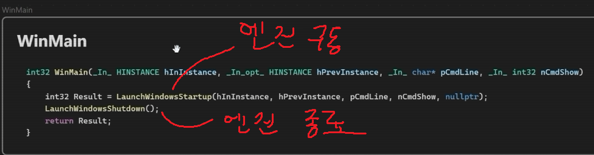
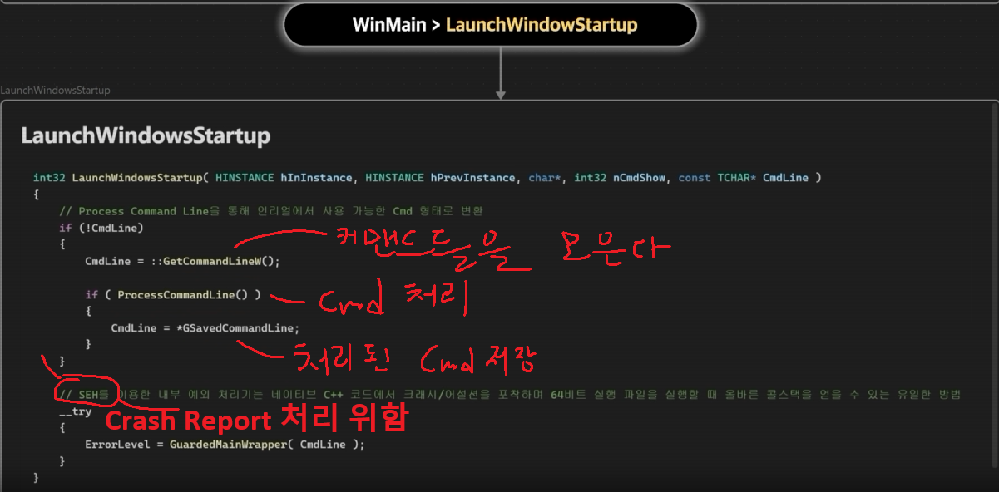
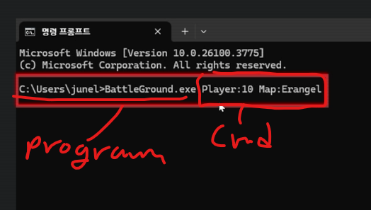
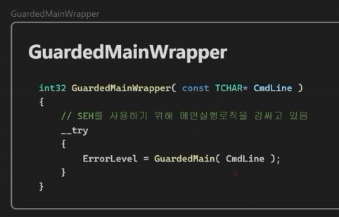
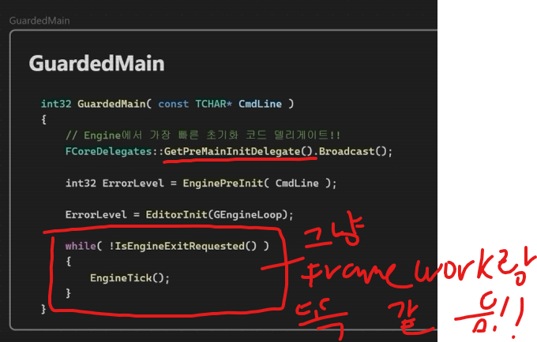
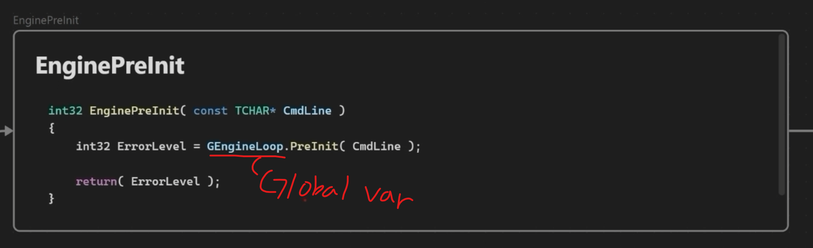
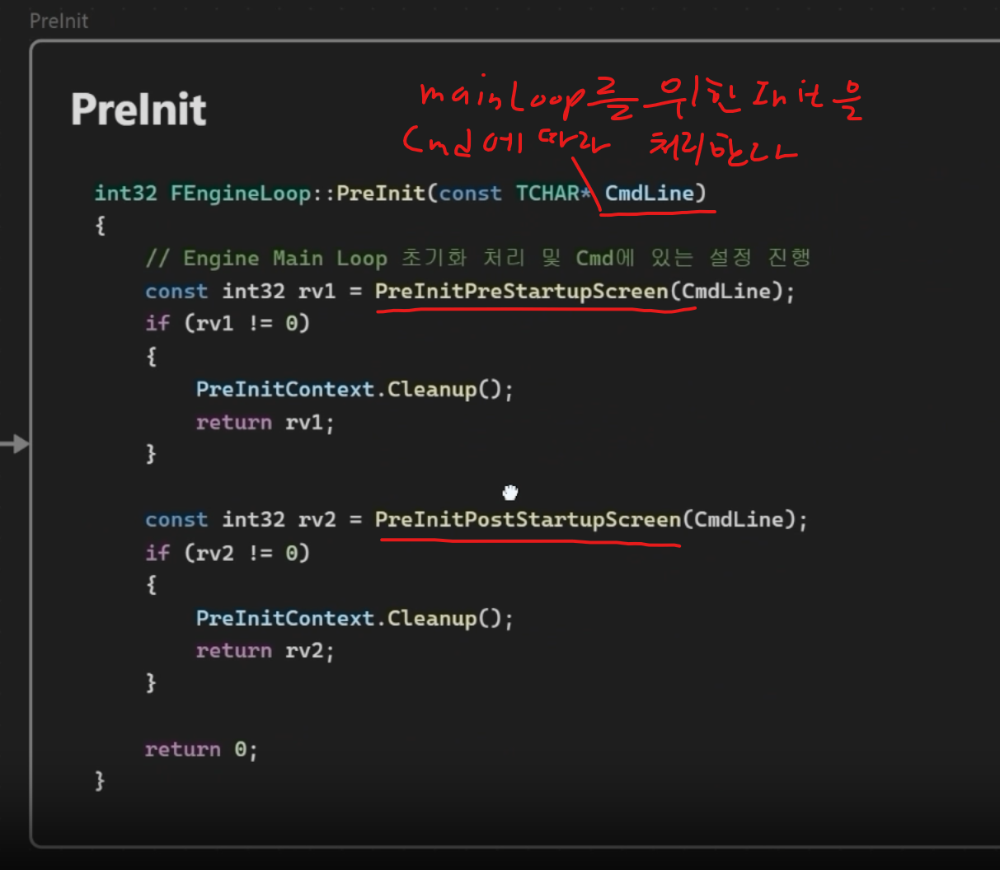
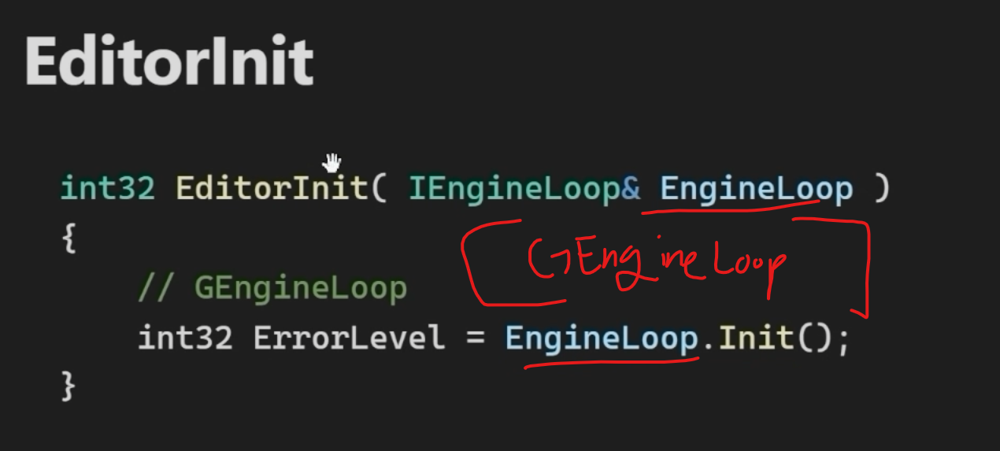
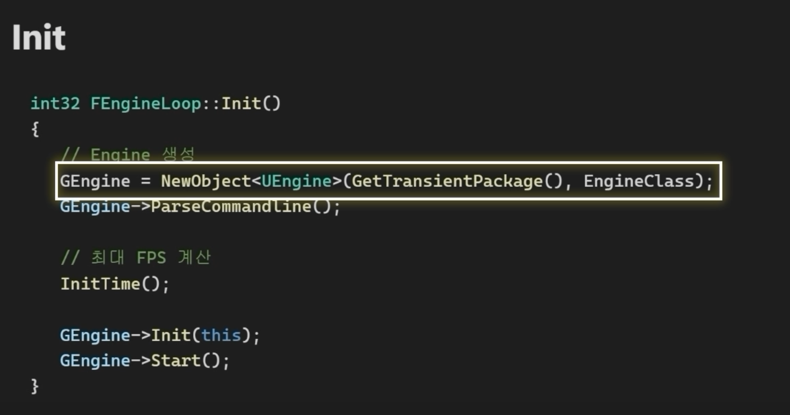

프로그램의 시작지점

WinMain : 언리얼엔진도 윈도우 프로그램이다. 

 <em>결국 얘도 WinMain에서 굴러간다</em>

멀티 플랫폼 환경에서 들어온 다양한 플랫폼의 커맨드들을 언리얼에서 이해가 가능한 공통 커맨드로 변환한다.

SEH(Structed Exception Handling)는 CrashReport가 안전하게 처리되도록 하는 기법이다 [luckygg.tistory.com](https://luckygg.tistory.com/374)

GuardedMain : 엔진의 초기화가 대부분 여기서 이루어진다.

 <em>GuardedMain을 try로 감싼 이유는 마찬가지로 CrashReport를 띄우기 위함</em>

<b>GuardedMain</b>.PreInit

및줄친 PreInitPreStartupScreen이 중요한 함수인데 뭐 Cmd써서 초기화를 하는구나 이해하면 됨

GuardedMain.EditorInit

언리얼은 에디터환경이랑 패키징환경이랑 기능·창이 다르다.

패키징은 완성품이기 때문에 게임 중간에 꺼서 게임을 수정한다던지 이런게 당연히 불가능하다.

하지만 에디터는 PIE모드에서 게임을 즐기고, 끈다음에 다시 게임을 수정해서 플레이할 수 가 있다. 따라서 에디터가 좀 더 큰 개념이라고 생각하면 된다.

<b>우리는 에디터로 개발을 하니까 에디터에서 발생하는 문제들에 대처할 줄 알아야한다.</b>

드 디 어 <b>엔진 객체를 동적할당</b>한다. <code>GEngineLoop.Init</code>  기억하자

컴퓨터로 치면 운영체제를 동적할당한것이다.

