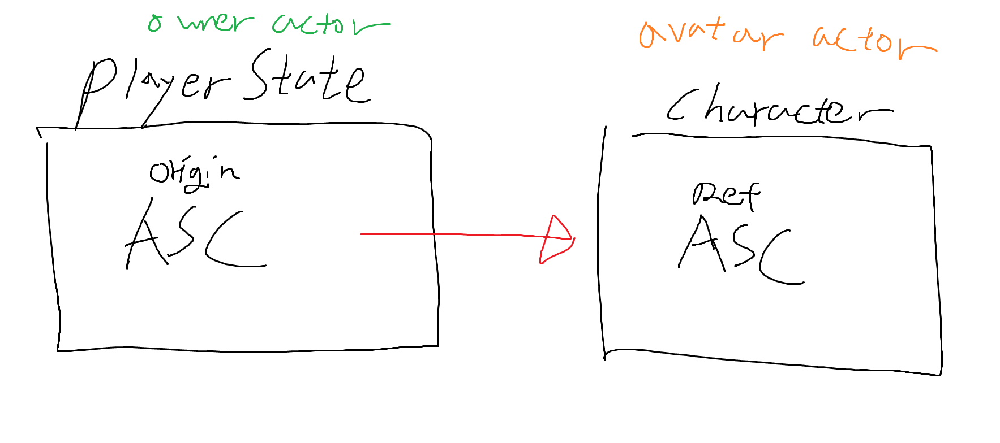
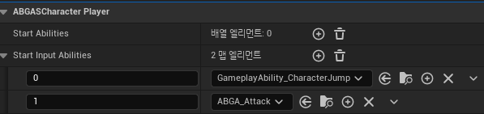
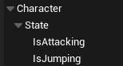
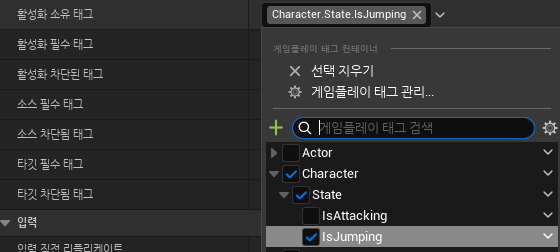
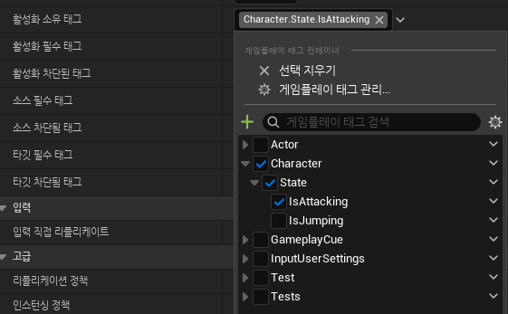
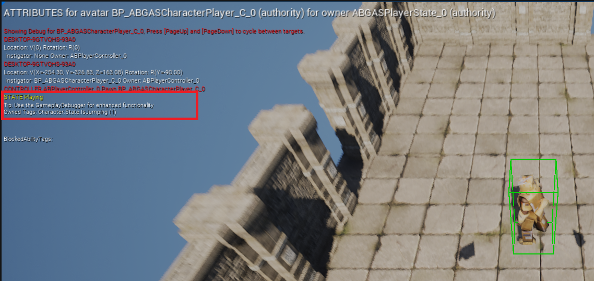

ASC : AbilitySystemComponent

---

멀티플레이를 고려하였을때 서버→클라로 배포되는 액터가<br />캐릭터에 Input등을 직접 설정하는 것보다 적합하다.

이때 자주 사용하는 액터는 플레이어 정보를 배포하는 <b>PlayerState</b>이다.

따라서 <b>Comp의 Owner를 PlayerState로 설정하고 Avatar를 Character로 설정하는 것이 일반적</b>



어빌리티 목록에 GAS기본 어빌리티인 Jump를 추가한다.



```c++
//MyCharacter.cpp

void AABGASCharacterPlayer::PossessedBy(AController* NewController)
{
    // 서버에서만 호출
    Super::PossessedBy(NewController);

    AABGASPlayerState* ABGASPlayerState = Cast<AABGASPlayerState>(GetPlayerState());
    if(ABGASPlayerState)
    {
		    // 빙의되는 순간 PlayerState에서 ASC를 받아온다. ASC는 PlayerState에서 생성된다.
        ASC = ABGASPlayerState->GetAbilitySystemComponent();
        ASC->InitAbilityActorInfo(ABGASPlayerState/*OwnerActor*/, this/*AvatarActor*/);
        
        int32 InputId = 0; // 생성하는 GA들에 Id를 부여한다.
        for (const auto& GA : StartAbilities)
        {
            FGameplayAbilitySpec StartSpec(GA);
            StartSpec.InputID = InputId++;
            ASC->GiveAbility(StartSpec);

            SetupGASInputComponent();
        }
    }
}

void AABGASCharacterPlayer::SetupGASInputComponent()
{
    if (IsValid(ASC) && InputComponent)
    {
        UEnhancedInputComponent* EnhancedInputComponent = CastChecked<UEnhancedInputComponent>(InputComponent);

				// 인자로 Id삽입
        EnhancedInputComponent->BindAction(JumpAction, ETriggerEvent::Triggered, this,
         &AABGASCharacterPlayer::GASInputPressed, 0); // 0번은 JumpAbility
        EnhancedInputComponent->BindAction(JumpAction, ETriggerEvent::Completed, this,
         &AABGASCharacterPlayer::GASInputReleased, 0);

    }
}


void AABGASCharacterPlayer::GASInputPressed(int32 InputId)
{
    FGameplayAbilitySpec* Spec =  ASC->FindAbilitySpecFromInputID(InputId);
    if (Spec)
    {
        if (Spec->IsActive())
        {
            ASC->AbilitySpecInputPressed(*Spec);
        }
        else
        {
            ASC->TryActivateAbility(Spec->Handle);
        }
    }
}

void AABGASCharacterPlayer::GASInputReleased(int32 InputId)
{
    FGameplayAbilitySpec* Spec = ASC->FindAbilitySpecFromInputID(InputId);
    if (Spec)
    {
        if (Spec->IsActive())
        {
            ASC->AbilitySpecInputReleased(*Spec);
        }
    }
}

```

### <b>ASC 입력  처리</b>

<ul>
<li>
EnhancedInputComponent의 BindAction함수를 사용하면 범용적 입력 처리 가능
</li>
<li>
GASpec에는 입력 값을 설정하는 필드 InputId가 제공된다.
</li>
<li>
ASC에 등록된 Spec을 검사해 입력에 매핑된 GA를 찾을 수 있음 <code>FindAbilitySpecFromInputId</code> 
</li>
<li>
사용자 입력이 들어오면 ASC에서 입력에 관련된 GA를 검색
</li>
<li>
해당 GA 발견하면 현재 발동중인지 판별

- <b>GA가 발동중이면</b> 입력이 왔다는 신호를 전달 <b><code>AbilitySpecInputPressed</code></b>
- <b>GA가 발동하지 않았으면</b> 새롭게 발동 <b><code>TryActivateAbility</code></b>
</li>
<li>
입력이 끝났을때도 동일하게 처리

<ul>
<li>
 <b><code>AbilitySpecInputReleased</code></b>
</li>
</ul>
</li>
</ul>

### 게임플레이 어빌리티의 인스턴싱 옵션

- 상황에 따라 다양한 인스턴스 정책 지정 가능
  - NonInstanced : 인스턴싱 없이 CDO에서 일괄 처리<br />(GA의 공통사항등 기본적인 정보를 처리할듯)
  - InstancedPerActor : 액터마다 하나의 GA Instance를 만들어서 처리<br />(가장 처음 생긴 인스턴스 : Primary Instance)
  - InstancePerExecution : GA 발동시 인스턴스를 생산.

(네트워크 리플리케이션 까지 고려했을때 InstancedPerActor가 무난함<br />보통은 Action은 한 Actor로 부터 시작해서 해당 Actor에서 종료되는게 일반적이다.)

---

<b>입력에 대한 애니메이션 처리</b>

- 플러그인 내에서 기본으로 제공하는 AbilityTask\_PlayMontageAndWait 클래스를 활용한다.

```c++
void UABGA_Attack::ActivateAbility(const FGameplayAbilitySpecHandle Handle, const FGameplayAbilityActorInfo* ActorInfo, const FGameplayAbilityActivationInfo ActivationInfo, const FGameplayEventData* TriggerEventData)
{
	Super::ActivateAbility(Handle, ActorInfo, ActivationInfo, TriggerEventData);

	AABCharacterBase* ABCharacter = CastChecked<AABCharacterBase>(ActorInfo->AvatarActor.Get());
	
	UAbilityTask_PlayMontageAndWait* PlayAttackTask = UAbilityTask_PlayMontageAndWait::CreatePlayMontageAndWaitProxy(this, TEXT("PlayATtack"), ABCharacter->GetComboActionMontage());
	PlayAttackTask->ReadyForActivation();
}

```

---

<b>GA.Tag사용</b>



위와 같이 태그 추가 후





각각의 GA의 ActivationOwnedTag에 추가시켜준다.

이렇게 되면 해당 GA가 발동중일때 추가해준 Tag들이 ASC에 부착되서 현재 상황을 파악이 가능해진다.



해당 태그가 동작중인지는 콘솔→showdebug abilitysystem을 입력해서 확인이 가능하다

```c++
APlayerController* PC = CastChecked<APlayerController>(NewController);
PC->ConsoleCommand(TEXT("showdebug abilitysystem"));
```

위의 코드를 입력해 자동화도 가능하다.

앵간해서는 GA와 AT는 자기 역할만 충실하게 구현하는것이 좋다(당연;;)

GamePlayTag를 cpp에서 설정하면 컴파일 횟수가 많아지니 좋은 방법이 아니기때문에 에디터를 통해 변경하도록 한다.
