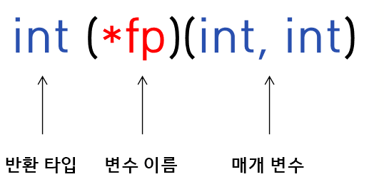

<a href="https://hwan-shell.tistory.com/87">hwan-shell.tistory.com</a>

<b>함수의 주소 값</b>을 지닐 수 있는 <b>포인터 변수 </b>함수 포인터에 대해 알아보자\~

---

<details>
<summary><b>선언 방법</b></summary>

```c++
int (*fp1)(); // 포인터니까 이름에*붙여서 선언한다
int (*fp2)(int);
int (*fp3)(int, int);
bool (*fp4)();
void (*fp5)();
void fnc_print(void(*fnc)()); // 매개인자로 함수포인터를 받아보자
void fnc_print(void(*fnc2)(n)); // 매개인자로 매개인자가 있는 함수 포인터를 받아보자
```



포인터니까 \*붙여서 선언한다

</details>

---

### <b>그래서 이거 왜 씀?</b>

- 가장 큰 이유는 Callback을 구현하기 위해서다
  - 함수의 인자로 다른 함수를 받아 원하는 시점에 함수를 불러오는데에 있어서 용이하게 사용할 수 있다.
