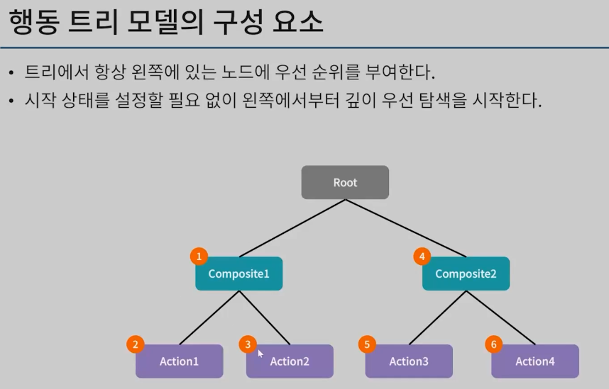
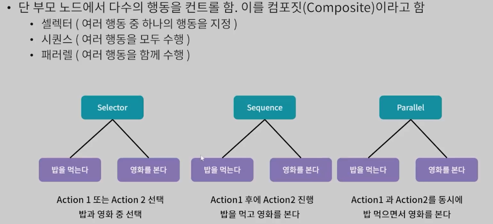
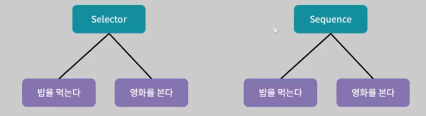
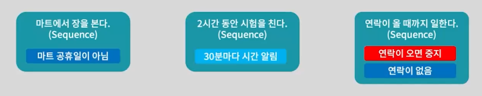
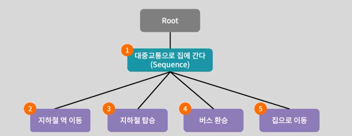
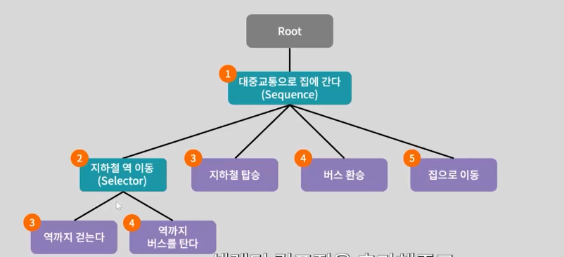
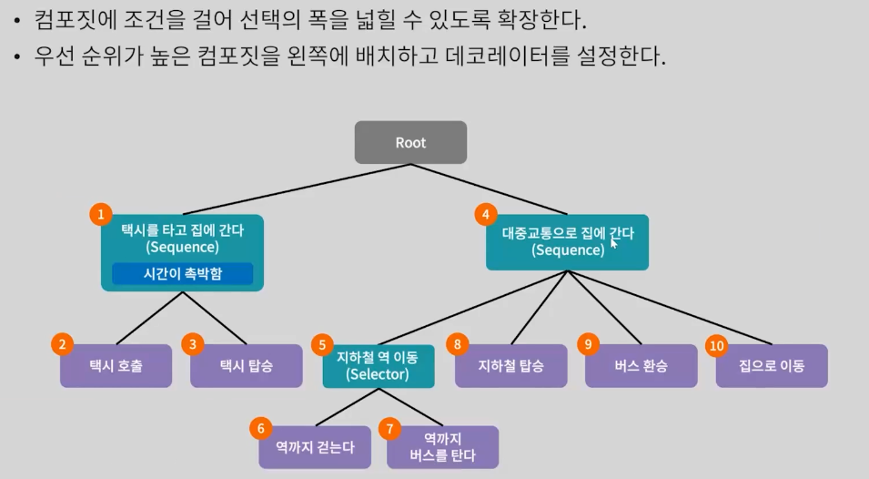

---

<b>우선순위와 트리를 사용해 인공지능을 설계하는 기법</b>

FSM이 가지고 있는 문제를 해결하기 위한 새로운 인공지능 기법이다

<b>행동트리 모델의 장점</b>

- 모듈화가 잘 되어있어 확장 용이함
- 트리를 사용해 계층화가 잘 되어있어 복잡한 인공지능 모델 설계가 쉬움
- 트리이기 때문에 다이어그램으로 모델을 표현하기가 쉬움
- 언리얼같은 경우는 부가기능이 겁나 많아서 다양한 상황에손쉽게 대처 가능

일반적인 DFS 트리 탐색과 같다

행동 트리 모델은 행동을 중심으로 설계된다.

하지만 이 행동들이 독자적으로 실행되는건 아니고 <b>컴포짓을 통해서만 실행된다.</b>

(컴포짓은 다수의 액션을 다룬다)

<b>행동에 대한 결과</b>

- 성공(Succeeded) : 행동의 성공
- 실패(Failed) : 행동의 실패
- 중지(Aborted) : 외부 요인으로 인한 행동의 실패
- 진행 중(InProgress) : 행동 결과를 홀딩

Selector : L이 실패하면 R 확인 R도 실패하면 실패, L이실패하면 전부 실패

Sequence : LR둘중 하나라도 실패라면 실패, L → R 둘다 성공하면 성공

<b>컴포짓 노드에 부착하는 추가기능</b>

<b>데코레이터</b> : 컴포짓 노드가 실행되는 조건 지정

<b>서비스</b> : 컴포짓 노드가 활성화 될 때 주기적으로 실행하는 부가 명령

<b>관찰자 중단</b> : 데코레이터 조건에 부합되면 컴포짓 내 활동을 모두 중단하고 루트에서 다시 시작

<b>행동트리 모델 생성 예시</b>

- 목적에 대한 행동들을 나눈다
  ex) 퇴근하고 집에가는 행동트리모델

  지하철 역까지 이동 - 지하철 탑승 - 버스 환승 - 문 앞에 도착

- 시퀀스 컴포짓을 통해 이것들을 묶는다
  (4가지가 순차적으로 이루어져야 하기 때문)

트리의 깊이를 활용해 행동을 더 세부적으로 나눌 수 있다

컴포짓에 조건을 걸어 선택의 폭을 넓힐수도 있다

