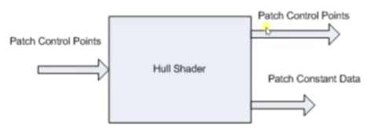

---

Hull 쉐이더는 테셀레이션 단계 전에 input으로 넣어준 patch control point들을 기준으로

프리미티브를 어떤방법으로 쪼갤지에 대해 결정한다.

Vertex Shader의 Output을 Input으로 받는다.

Hull Shader는 기본적으로 Output으로 다른 쉐이더들과 비슷하게 구조체를 반환하나.

추가적으로 <b>함수를 출력</b>하는 형태이다.

즉 Hull Shader에서는 Input으로 들어온

Patch Conttol Points를 변환한 후 출력할 수 있고

어떻게 쪼개줄지에 대한 Patch Constant Data를 전해줄 수 있다.



```c++

struct VertexOut
{
    float4 pos : POSITION;
};

// 기본 Output
struct HullOut
{
    float3 pos : POSITION;
};

// 함수에서 반환할 구조체
struct PatchConstOutput
{
    float edges[4] : SV_TessFactor;
    float inside[2] : SV_InsideTessFactor;
};

// 출력될 함수                  VertexOut 4개짜리 배열 (각 모서리 점 4개의 좌표)
PatchConstOutput MyPatchConstantFunc(InputPatch<VertexOut, 4> patch,
                                     uint patchID : SV_PrimitiveID)
{
    PatchConstOutput pt;
    
    pt.edges[0] = edges[0];
    pt.edges[1] = edges[1];
    pt.edges[2] = edges[2];
    pt.edges[3] = edges[3];	
    pt.inside[0] = inside[0];
    pt.inside[1] = inside[1];
	
    return pt;
}

[domain("quad")] // 사각형 프리미티브의 patch로 그리겠다.
[partitioning("integer")] // 어떤방법으로 쪼갤지
[outputtopology("triangle_cw")] // 시계방향의 삼각형으로 만들거임
[outputcontrolpoints(4)] // gpu 쓰레드 하나당 출력하는 control point
[patchconstantfunc("MyPatchConstantFunc")] // 출력 함수 이름
[maxtessfactor(64.0f)] // 한쪽 edge에서 쪼갤수 있는 최대 수
HullOut main(InputPatch<VertexOut, 4> p,
           uint i : SV_OutputControlPointID, // Topology에 따라 0~n - 1 만큼 들어옴 for문처럼 동작한다고 생각하자
           uint patchId : SV_PrimitiveID)
{
    HullOut hout;
	
    hout.pos = p[i].pos.xyz; // vertex로부터 받아온 점 4개 그대로 return

    return hout;
}
```
