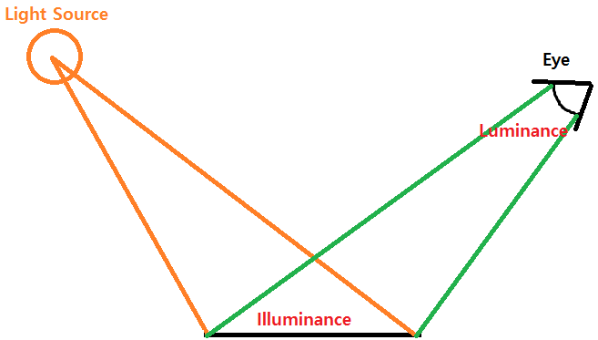
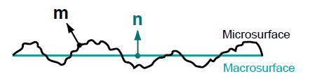
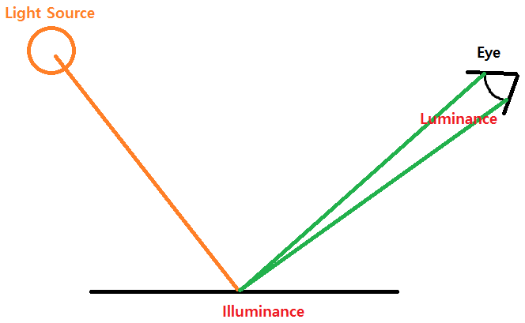
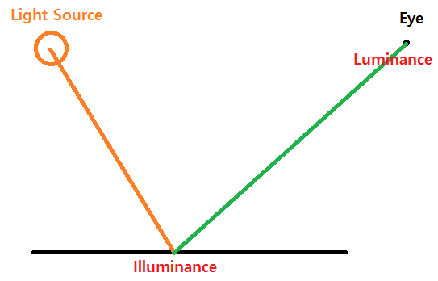
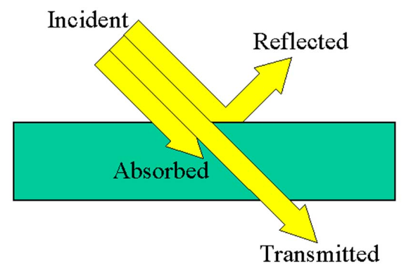

---

휘도는 특정 방향으로 이동하는 단위 면적당 광도(luminance)를 측정한 것이다.

그냥 쉽게 말해서 우리 눈으로 들어오는 빛의 양을 측정하는 것이다.

지금까지 넓은 표면과 큰 면적의 눈을 중심으로 빛에 대해 설명했다면 이젠

미세 표면과 핀홀(pin-hole) 카메라를 중심으로 설명을 한다.

(그렇지 않으면 계산이 너무 복잡해짐)

macrosurface라고 넓은 표면은 아니고 점에 가까운 표면이지만, 그것을 더 확대했을때의 표면을 microsurface라고 부른다.

이러면 우리가 구하고자 하는 조도는

이렇게 측정될 것이다.

여기서 핀홀 카메라까지 사용하면 해당 그림처럼 된다.

<b>조도와 휘도의 구분 이유</b>

이 그림이 또 나왔다.

어떤 표면에 입사한 빛은 100% 사람 눈으로 반사되지 않는다.

모든 표면은 빛을 흡수( Absorbtion ), 반사( Reflection ), 투과( Transmission )시키기 때문이다.

게다가 이 반사 성분은 확산반사( diffuse reflection ) 성분과 정반사( specular reflection, 거울면 반사로 나뉘어 반사되는 빛도 100% 우리 눈에 들어오지 않는다.

이 중에 우리 눈에 들어올 수 있는 성분은 <b>반사와 투과</b>이다.

앞으로 만나볼

<b>Albedo( 표면 반사율 )</b>

<b>BRDF( Bidriectional Reflectance Distribution Function, 양방향 반사도 분산 함수 )</b>

<b>BTDF( Bidirectional Transmittance Distribution Function, 양방향 투과도 분산 함수 )</b>

얘네들은 빛이 얼마나 반사되고 투과되는지를 함수로 표현한 것이다.

(대부분의 렌더링 기술들이 이들을 사용한다)
